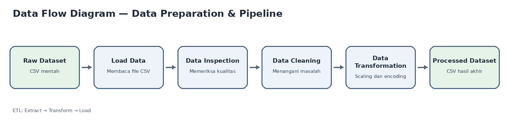

# Data Preparation & Pipeline Project – Dataset Otomotif

Proyek ini membangun pipeline ETL sederhana dengan Python dan Pandas. Pipeline memuat dataset otomotif yang masih kotor, memeriksa kondisinya, membersihkannya, mentransformasinya, lalu menyimpan hasilnya sebagai dataset baru yang siap dipakai untuk analisis atau pemodelan. Dataset mentah tidak pernah ditimpa atau diubah.

---

## 1. Alur ETL (ringkasan)



| Tahap ETL | Function di `pipeline.py` | Apa yang dilakukan | Input → Output |
|---|---|---|---|
| **Extract** | `load_data()` | Membaca file CSV mentah dengan Pandas. File hanya dibaca, tidak pernah ditulis. | `data/raw/automobileEDA_dirty_training.csv` → DataFrame |
| **Transform** | `inspect_data()` | Memeriksa kondisi awal data dan mencetak temuan ke terminal. | DataFrame mentah → temuan masalah |
| **Transform** | `clean_data()` | Memperbaiki masalah yang ditemukan saat inspeksi. | DataFrame mentah → DataFrame bersih |
| **Transform** | `transform_data()` | Min-Max Scaling pada kolom numerik dan encoding pada kolom kategorikal. | DataFrame bersih → DataFrame siap pakai |
| **Load** | `save_data()` | Menyimpan hasil sebagai file baru di `data/processed/`. File mentah tidak pernah ditulis. | DataFrame siap pakai → `data/processed/automobileEDA_processed.csv` |

`run_pipeline()` menjalankan kelima function tersebut berurutan dalam satu kali eksekusi. Urutannya sengaja **inspeksi → cleaning → transformasi**: masalah harus ditemukan dulu sebelum diperbaiki, dan data harus bersih dulu sebelum di-scaling. Jika scaling dilakukan sebelum cleaning, nilai min dan max akan terpengaruh oleh data kosong, duplikat, dan nilai yang salah tulis.

Di akhir proses, script membaca ulang file mentah dan membandingkannya dengan data awal untuk memastikan file mentah tidak berubah (`Raw file unchanged: True`).

---

## 2. Deskripsi dan sumber dataset

- **Isi:** 205 baris data mobil dengan 30 kolom: spesifikasi (`make`, `body-style`, `engine-size`, `horsepower`, `curb-weight`, `city-mpg`, dll.), `price` (target), dan `transaction_date`.
- **Sumber:** `automobileEDA_dirty_training.csv` dari mentor (`Dataset_Sesi_3.zip`), versi dataset otomotif yang sengaja dibuat kotor. `automobile_processed.csv` hanya dipakai sebagai pembanding. Dataset hasil dibuat oleh `pipeline.py`, bukan disalin dari dataset mentor.

## 3. Struktur folder

```
data-pipeline-assignment/
├── data/
│   ├── raw/automobileEDA_dirty_training.csv       # input, tidak diubah
│   └── processed/automobileEDA_processed.csv      # output pipeline
├── src/pipeline.py
├── documentation/data-flow-diagram.png
├── README.md
└── requirements.txt
```

---

## 4. Inspeksi data: temuan awal dan alasannya

Inspeksi dilakukan lebih dulu karena keputusan cleaning harus didasarkan pada kondisi data yang nyata, bukan asumsi. Semua hasilnya dicetak ke terminal saat `pipeline.py` dijalankan: 5 baris pertama, jumlah baris dan kolom, nama kolom, tipe data, jumlah missing values, jumlah duplikat, dan nilai unik kolom kategorikal.

| Pemeriksaan | Temuan | Mengapa penting |
|---|---|---|
| Ukuran awal | 205 baris × 30 kolom | Sebagai pembanding jumlah data sebelum dan sesudah cleaning |
| Missing values | 17 sel kosong: `stroke` (4), `horsepower` (3), `price` (3), `transaction_date` (2), `make` (2), `num-of-doors` (2), `horsepower-binned` (1) | Model tidak bisa memproses nilai kosong, dan setiap kolom perlu cara penanganan yang berbeda |
| Duplikat | 4 baris duplikat persis | Baris ganda membuat satu record terhitung dua kali |
| Tipe data salah | `transaction_date` bertipe teks, bukan tanggal | Teks tidak bisa diurutkan atau dihitung sebagai tanggal |
| Format tanggal campur | `YYYY-MM-DD` (51), `DD/MM/YYYY` (52), `DD-Mon-YYYY` (50), `MM-DD-YYYY` (50), kosong (2) | Satu kolom dengan empat format akan salah terbaca jika diparse dengan satu format saja |
| Penulisan kategori tidak konsisten | `make`: 27 nilai unik, menjadi 22 setelah trim dan lowercase (`ALFA-ROMERO`, `Audi`, `BMW`, `dodge  `, `mercury  `, `porsche  `); `body-style`: 7 menjadi 5 (`SEDAN`, `Sedan`); `drive-wheels`: 5 menjadi 4 (`AWD`, `RWD`); `fuel-system`: 10 menjadi 8 (`MPFI`, `Mpfi`) | Komputer menganggap `SEDAN` dan `sedan` sebagai dua kategori berbeda |
| Skala numerik tidak seragam | `price` 5.118–45.400, `curb-weight` 1.488–4.066, `compression-ratio` 7–23, sedangkan `length` dan `width` sudah berskala 0–1 | Kolom berskala besar mendominasi kolom berskala kecil pada banyak algoritma |
| Kolom kategorikal masih teks | `make`, `aspiration`, `num-of-doors`, `body-style`, `drive-wheels`, `engine-location`, `engine-type`, `num-of-cylinders`, `fuel-system`, `horsepower-binned` | Model membutuhkan angka |
| Nilai tidak wajar | Tidak ada nilai nol atau negatif pada kolom yang harus positif. `symboling` negatif itu valid karena merupakan rating risiko | Pemeriksaan ini memastikan tidak ada nilai mustahil yang lolos |

Inspeksi juga mengecek duplikat setelah teks dirapikan, serta kolom numerik yang tersimpan sebagai teks. Pada dataset ini tidak ditemukan kolom numerik bertipe teks.

---

## 5. Data cleaning: keputusan dan alasannya

Cleaning hanya dilakukan untuk masalah yang benar-benar ditemukan saat inspeksi. Urutan langkah di `clean_data()` juga disengaja: tanggal dan teks dirapikan lebih dulu, baru duplikat dihapus, dan terakhir missing values ditangani.

| # | Masalah | Kolom | Metode | Alasan |
|---|---|---|---|---|
| 1 | Format tanggal campur | `transaction_date` | Setiap format diparse dengan polanya sendiri, lalu disimpan sebagai `YYYY-MM-DD` | Tanda `/` dibaca **hari-bulan** (`DD/MM/YYYY`), sedangkan tanda `-` yang berisi angka saja dibaca **bulan-hari** (`MM-DD-YYYY`). Dugaan ini diverifikasi: baris data adalah tanggal harian berurutan, dan hasil parse memang berurutan secara kronologis. `pd.to_datetime(format="mixed")` **tidak dipakai** karena menganggap semua tanggal bulan-hari: `02/01/2025` terbaca 1 Februari (seharusnya 2 Januari) dan 21 baris menjadi tidak berurutan |
| 2 | Tanggal kosong (2) | `transaction_date` | Diisi dengan interpolasi dari baris di sekitarnya | Data berurutan satu per hari, sehingga tanggal yang hilang bisa dihitung dari tetangganya. Mean atau modus tanggal akan menghasilkan tanggal yang salah |
| 3 | Penulisan tidak konsisten dan spasi berlebih | semua kolom teks (terutama `make`, `body-style`, `drive-wheels`, `fuel-system`) | `strip()` + lowercase | Satu kategori harus punya satu penulisan. Jika tidak, one-hot encoding akan membuat kolom ganda (`body-style_SEDAN` dan `body-style_sedan`) |
| 4 | Duplikat (4) | semua kolom | `drop_duplicates()` setelah tanggal dan teks dirapikan | Pengecekan dilakukan setelah standardisasi agar duplikat yang tersembunyi oleh perbedaan huruf, spasi, atau format tanggal ikut terdeteksi. Baris yang sama akan membuat satu record terhitung dua kali |
| 5 | `price` kosong (3) | `price` | **Baris dihapus** | `price` adalah target (label). Mengisinya dengan median atau mean berarti mengarang jawaban yang seharusnya diprediksi model. Hanya 3 baris (sekitar 1,5%), sehingga kehilangan datanya kecil |
| 6 | Numerik kosong | `stroke` (4), `horsepower` (3) | Diisi dengan **median** | Kedua kolom memiliki outlier, dan median tidak ikut tertarik oleh nilai ekstrem seperti mean |
| 7 | Label kategori kosong | `horsepower-binned` (1) | **Dihitung ulang** dari `horsepower` memakai batas kelompok yang terlihat di data (`low` ≤ 101, `medium` ≤ 155, `high` ≥ 156) | `horsepower-binned` hanyalah hasil pengelompokan `horsepower` (`Low`/`Medium`/`High`), sehingga nilainya bisa dihitung, bukan ditebak |
| 8 | `make` kosong | `make` | Diisi `unknown` | Mengisi dengan modus berarti mengarang merek mobil. `unknown` jujur menyatakan bahwa merek tidak diketahui |
| 9 | `num-of-doors` kosong (2) | `num-of-doors` | Diisi dengan **modus** (`four`) | Kolom hanya punya dua nilai, sehingga nilai paling sering adalah tebakan paling aman |
| 10 | Outlier | `price`, `engine-size`, `stroke`, dll. | **Dilaporkan, tetapi dipertahankan** | Mobil mewah atau mesin besar adalah data yang valid, bukan kesalahan. Menghapusnya akan membuang informasi nyata |

### Jumlah data sebelum dan sesudah cleaning

| | Sebelum | Sesudah |
|---|---|---|
| Jumlah baris | 205 | **198** (−4 duplikat, −3 `price` kosong) |
| Missing values | 17 | **0** |
| Baris duplikat | 4 | **0** |

Script mencetak semua angka di atas ke terminal, beserta daftar kolom yang berubah dan cara perubahannya.

### Keterbatasan yang diketahui

- Penulisan `peugot` di dataset asli dibiarkan karena itu ejaan sumber data, bukan kesalahan ketik yang disisipkan.
- Beberapa baris tampaknya salah label pada `make` (misalnya baris dengan spesifikasi Honda yang berlabel `Audi`). Hal ini tidak bisa dikoreksi secara otomatis tanpa data pembanding, sehingga dibiarkan.

---

## 6. Transformasi data: keputusan dan alasannya

### 6.1 Min-Max Scaling

Memakai `MinMaxScaler` dari scikit-learn. Rumusnya `(x − min) / (max − min)`, sehingga semua nilai berada di rentang 0–1.

| Kolom | Alasan |
|---|---|
| `normalized-losses`, `wheel-base`, `height`, `curb-weight`, `engine-size`, `bore`, `stroke`, `compression-ratio`, `horsepower`, `peak-rpm`, `city-mpg`, `highway-mpg`, `city-L/100km` | Rentang nilainya sangat berbeda (puluhan sampai ribuan). Scaling menyamakan skala agar tidak ada kolom yang mendominasi |

Kolom yang **tidak** di-scaling, beserta alasannya:
- `length` dan `width`: sudah berskala 0–1 di data asli.
- `diesel` dan `gas`: sudah biner (0/1).
- `symboling`: rating risiko yang nilainya sudah bermakna apa adanya.
- `price`: target prediksi, dibiarkan pada satuan aslinya agar mudah dibaca.

Hasil scaling disimpan sebagai kolom baru `<kolom>_scaled`, dan kolom aslinya tetap ada agar nilai sebelum dan sesudah bisa dibandingkan.

### 6.2 Encoding kolom kategorikal

Pemilihan metode disesuaikan dengan sifat tiap kolom:

| Metode | Kolom | Alasan | Kolom baru |
|---|---|---|---|
| **Ordinal (kata → angka)** | `num-of-doors`, `num-of-cylinders` | Nilainya memang angka yang ditulis dengan kata (`two` = 2, `four` = 4, `twelve` = 12), sehingga urutan dan jaraknya bermakna | `num-of-doors_num`, `num-of-cylinders_num` |
| **Ordinal (berurutan)** | `horsepower-binned` | Ada urutan alami: `low` < `medium` < `high` (0, 1, 2) | `horsepower-binned_ordinal` |
| **One-hot** | `aspiration`, `body-style`, `drive-wheels`, `engine-location`, `engine-type`, `fuel-system` | Kategori nominal tanpa urutan, dan jumlah kategorinya sedikit (≤ 10). Label angka biasa akan menciptakan urutan palsu | `<kolom>_<nilai>` (misal `body-style_sedan`) |
| **Frequency encoding** | `make` (22 merek) | One-hot akan menambah 22 kolom dan membuat data terlalu lebar. Frekuensi kemunculan merek mengubahnya menjadi satu kolom angka | `make_freq` |

Jumlah kolom bertambah dari 30 menjadi **74** karena kolom asli dipertahankan di samping kolom hasil transformasi.

### 6.3 Contoh nilai sebelum dan sesudah

**Min-Max Scaling**

| `normalized-losses` (sebelum) | `normalized-losses_scaled` (sesudah) | `wheel-base` (sebelum) | `wheel-base_scaled` (sesudah) |
|---|---|---|---|
| 122 | 0.2984 | 88.6 | 0.0583 |
| 164 | 0.5183 | 99.8 | 0.3848 |

**Encoding**

| Kolom | Sebelum | Sesudah |
|---|---|---|
| `num-of-doors` | `two` / `four` | `num-of-doors_num` = 2 / 4 |
| `num-of-cylinders` | `four` / `six` / `five` | `num-of-cylinders_num` = 4 / 6 / 5 |
| `horsepower-binned` | `medium` | `horsepower-binned_ordinal` = 1 |
| `body-style` | `convertible` | `body-style_convertible` = 1 (kolom `body-style_*` lainnya 0) |
| `make` | `alfa-romero` | `make_freq` = 0.0152 (3 dari 198 baris) |

---

## 7. Cara menjalankan

Instal dependency (Pandas, NumPy, dan scikit-learn untuk `MinMaxScaler`):

```bash
pip install -r requirements.txt
```

Jalankan pipeline dari folder utama proyek:

```bash
python src/pipeline.py
```

Dataset hasil tersimpan otomatis di `data/processed/automobileEDA_processed.csv` (198 baris × 74 kolom). Pipeline dapat dijalankan ulang kapan saja dengan hasil yang sama.